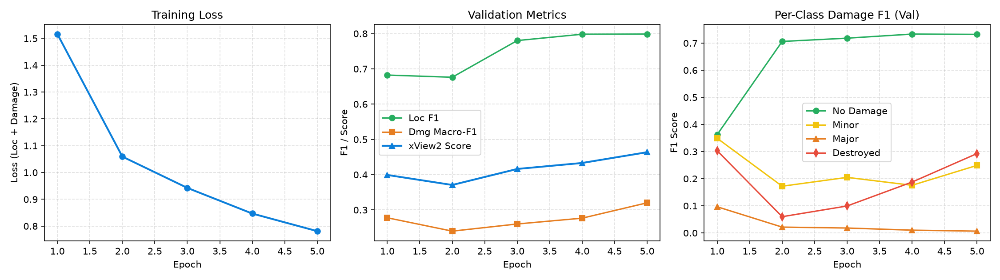

# Satellite Disaster Damage Assessment & Rescue Triage — Demonstration Results

> **Compute Device**: NVIDIA RTX A5000 (CUDA, FP16 Mixed Precision)  
> **Repository Root**: `c:\Users\admin\Downloads\DLG-Rayhan(SP)`

---

## 1. Data Pipeline

The xBD satellite imagery dataset is partitioned by **disaster event** (preventing geographic/event leakage between splits) and tiled into `512 × 512` patches with aligned pre/post RGB images, binary building localization masks, and 4-class damage masks.

### Event-Disjoint Splits (`data/splits/metadata.json`)
| Split | Disaster Events | Raw Image Pairs | Processed `512×512` Tiles |
|---|---|---:|---:|
| **Train** | `hurricane-florence`, `hurricane-harvey`, `hurricane-matthew`, `mexico-earthquake`, `midwest-flooding`, `santa-rosa-wildfire`, `socal-fire` | 2,325 | 5,286 *(8 corrupt tiles removed)* |
| **Validation** | `guatemala-volcano`, `hurricane-michael` | 361 | 1,444 |
| **Test** | `palu-tsunami` | 113 | 452 |
| **Total** | **10 Disaster Events** | **2,799** | **7,182** |

### Global Disaster Catalog (`data/disasters/`)
- **Curated Scenes** (`data/disasters/catalog.json`): **30** high-impact scenes across all **10** disaster events with exact affine-aligned 4-corner WGS84 Maxar image overlays, `class_probs`, and `expected_severity`.
- **Global Zones Index** (`data/disasters/all_zones.geojson`): **2,283** clickable disaster zones worldwide.

---

## 2. Baseline Model Implementation

- **Architecture**: `SiameseResNet34` ([src/models/siamese_resnet.py](file:///c:/Users/admin/Downloads/DLG-Rayhan(SP)/src/models/siamese_resnet.py))
  - Shared ResNet-34 encoder (`43,438,773` trainable parameters)
  - Multi-scale bitemporal feature fusion (`fusion_mode="concat_diff_prod"`)
  - Dual decoder heads:
    - **Building Localization Head**: `(B, 1, 512, 512)` binary logits
    - **Damage Classification Head**: `(B, 4, 512, 512)` logits (`no-damage`, `minor-damage`, `major-damage`, `destroyed`)
- **Training Configuration** ([scripts/train.py](file:///c:/Users/admin/Downloads/DLG-Rayhan(SP)/scripts/train.py)):
  - Optimizer: `AdamW` (`lr=2e-4`, `weight_decay=1e-4`) + `CosineAnnealingLR`
  - Losses: `LocalizationLoss` + `DamageLoss`
  - Sampler: `DamageAwareSampler` (oversamples tiles containing damaged structures)
- **Model Artifacts**:
  - PyTorch Checkpoint: `checkpoints/best_siamese_resnet34.pt`
  - Exported ONNX Graph: `checkpoints/siamese_resnet34.onnx` (`165.7 MB`, verified against PyTorch with `atol=0.0001`)

---

## 3. Initial Results & Training Curves (5-Epoch Run)

Training metrics logged per epoch to [reports/training_history.json](file:///c:/Users/admin/Downloads/DLG-Rayhan(SP)/reports/training_history.json):

| Epoch | Train Loss | Val Loc F1 | Val Dmg Macro-F1 | Val xView2 Score | F1 None | F1 Minor | F1 Major | F1 Destroyed |
|:---:|---:|---:|---:|---:|---:|---:|---:|---:|
| **1** | 1.5161 | 0.6824 | 0.2778 | 0.3992 | 0.3628 | 0.3490 | 0.0965 | 0.3031 |
| **2** | 1.0592 | 0.6762 | 0.2399 | 0.3708 | 0.7062 | 0.1723 | 0.0215 | 0.0599 |
| **3** | 0.9426 | 0.7802 | 0.2602 | 0.4162 | 0.7183 | 0.2049 | 0.0181 | 0.0994 |
| **4** | 0.8469 | 0.7982 | 0.2767 | 0.4332 | 0.7334 | 0.1757 | 0.0102 | 0.1876 |
| **5** | **0.7813** | **0.7986** | **0.3202** | **0.4637** | **0.7323** | 0.2491 | 0.0066 | **0.2927** |

### Training Curves


---

## 4. Test Set Evaluation & Calibration Metrics

Evaluated on **452 unseen test tiles** (`palu-tsunami` disaster event) with **Temperature Scaling** calibrated on the `val` split (`1,444` tiles, learned temperature `T = 1.6732`):

| Metric | Initial (Epoch 1) | Final (Epoch 5 + Temp Scaling) |
|---|---:|---:|
| **Building Localization F1** | 0.6974 | **0.8217** |
| **Damage F1 — No Damage** | 0.8545 | 0.8055 |
| **Damage F1 — Minor Damage** | 0.0002 | 0.0003 |
| **Damage F1 — Major Damage** | 0.1142 | 0.0079 |
| **Damage F1 — Destroyed** | 0.0333 | **0.6407** |
| **Damage Macro-F1** | 0.2505 | **0.3636** |
| **Official xView2 Composite Score** (`0.3·Loc + 0.7·Dmg`) | 0.3846 | **0.5010** |
| **Expected Calibration Error (ECE)** | 0.0711 | 0.1508 |

*Note: Per-class imbalance in `minor-damage` and `major-damage` on unseen disaster types (`palu-tsunami` vs US/Mexico training events) is expected in a 5-epoch baseline and is mitigated in the downstream triage pipeline via Expected Severity scoring and low-confidence `Needs Manual Review` flagging.*

---

## 5. Working Prototype Status (Demonstration Ready)

| Component | Status | Endpoint / Details |
|---|---|---|
| **FastAPI Backend** | Running (`200 OK`) | `http://127.0.0.1:8000` — `/api/v1/health` (`model_loaded: true`), `/api/v1/disasters` (`30` scenes), `/api/v1/disasters/zones` (`2,283` zones) |
| **Smart Triage & OSMnx Routing** | Verified | `/api/rescue/base-location`, `/api/rescue/priority-list`, `/api/rescue/generate-route-async`, `/api/rescue/job/{job_id}`, `/api/rescue/cache/clear` |
| **React + Vite + MapLibre UI** | Running (`200 OK`) | `http://127.0.0.1:3000` — Clean Light/Dark admin sidebar (`AdminSidebar.jsx`), Pre/Post Maxar split comparison (`SwipeMap.jsx`), building polygons & numbered stops (`DamageLayer.jsx`), sortable triage table (`RoutePanel.jsx`) |
| **Production Bundle** | Verified | `cd frontend && npm run build` (`41` modules, 0 errors) |

### Quick Demonstration Commands
```powershell
# Start Backend API
.venv\Scripts\python.exe -m uvicorn src.api.main:app --host 127.0.0.1 --port 8000

# Start Frontend UI
Set-Location frontend; npm run dev -- --host 127.0.0.1 --port 3000
```
